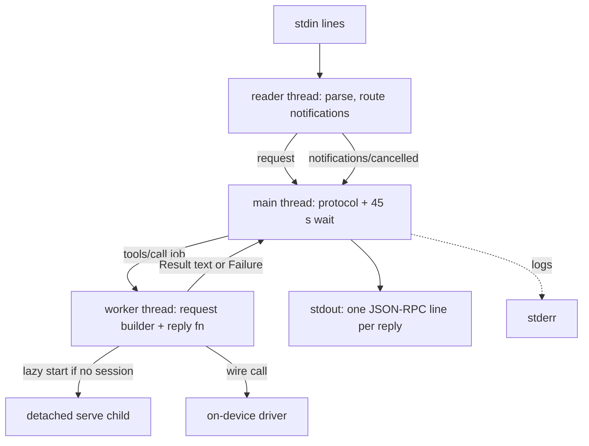
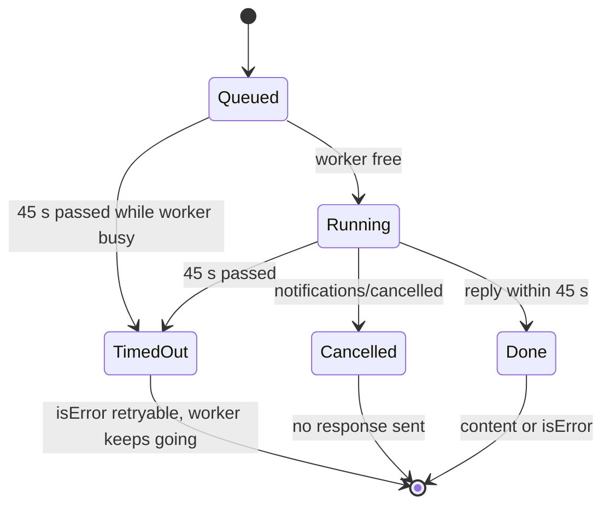
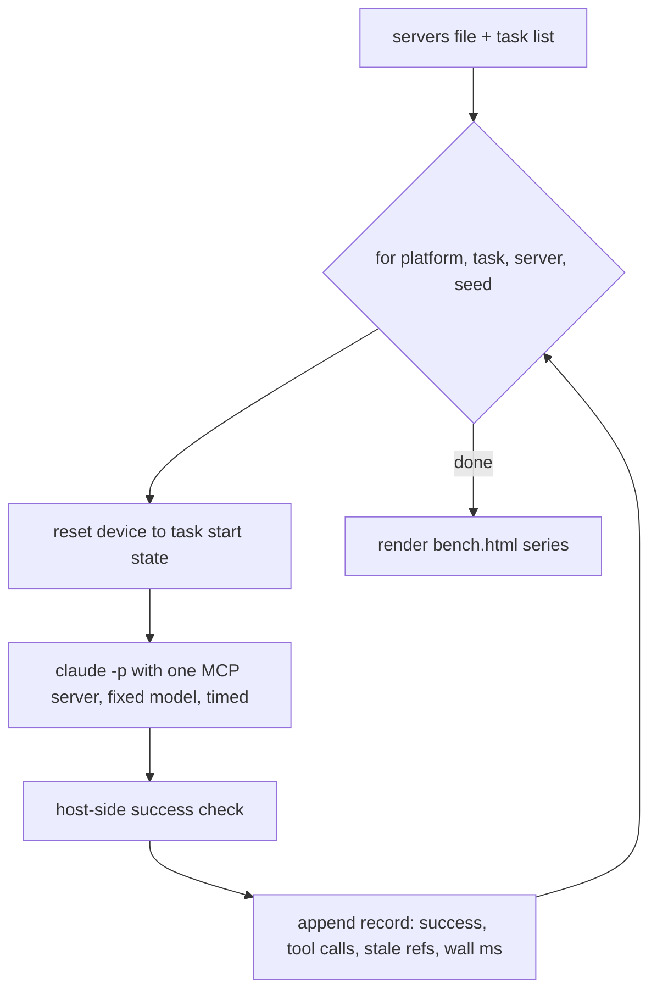
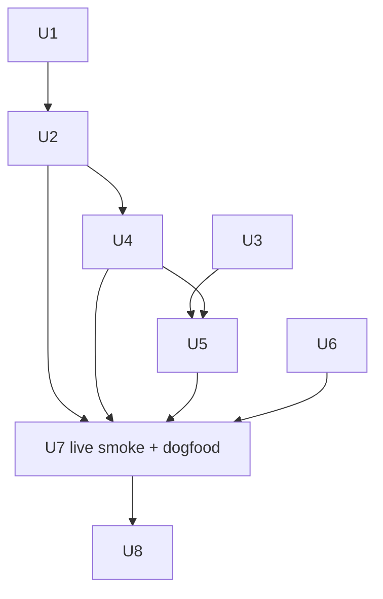

# P3 Reliability Gate - Plan

## Goal Capsule

- **Objective:** An agent in any stock MCP client can drive an iOS simulator or Android emulator through agent-mobile over MCP, and the reliability of that loop can be measured against two existing mobile MCP servers on identical tasks.
- **Means:** a stdio MCP server inside the existing binary (KTD1, KTD2), the settle and system-alert fixes in both drivers (KTD5, KTD6), a host-side `scroll_until_visible` verb (KTD7), and an agent-task harness on top of `scripts/benchkit` (KTD8).
- **Authority:** `docs/PRD.md` v0.4 §5.4 and §6.3 own product behavior; this plan's R-IDs refine them; KTDs own mechanism; units own neither.
- **Stop conditions:** stop and report if the stdout-clean refactor (U1) cannot keep every existing CLI test green, or if a stock client cannot complete `tools/list` plus one `snapshot` call against a live device.
- **Execution profile:** four tracks; Rust CLI (U1, U2, U4), drivers (U3, U5), harness (U6), docs (U8). Tracks own disjoint files and run in parallel; units inside a track run in order. The one shared file, `src/cmd/skills.rs`, is why U5 waits for U4.
- **Finish:** one PR on `feat/p3-reliability-gate`, CI green, with a live Inspector dogfood transcript and a harness smoke run in the PR body.

---

## Product Contract

### Summary

Add `agent-mobile mcp`, a stdio MCP server that exposes the CLI verbs as tools with the same argument shapes and error contract. Tighten settle so an action cannot report settled while a layout pass is pending, and surface system permission dialogs in the snapshot. Add `scroll_until_visible`. Extend the benchmark package with an agent-task harness that runs a fixed model against any MCP server and checks task success from the host.

### Problem Frame

P3 is the gate that decides whether the product continues (PRD §10). The two comparison servers are MCP servers, so a fair comparison needs agent-mobile behind the same interface and the same agent harness. Today agent-mobile is only a CLI, every verb prints straight to stdout, and the benchmark measures single-verb latency rather than task success. The early-settle case from Experiment 7 and the missing permission-dialog surface are the two contract gaps an agent hits most in task loops.

### Requirements

**MCP server**
- R1. `agent-mobile mcp` speaks newline-delimited JSON-RPC on stdio and supports both the 2026-07-28 stateless revision and the 2025-11-25 `initialize` handshake on the same connection (PRD §5.4).
- R2. Every CLI verb except `serve` and `mcp` is a tool with the CLI's argument shapes, annotations per PRD §5.4, and the same driver contract: refs, settle, and typed errors.
- R3. Typed driver errors return a tool result with `isError:true` carrying the code and next action; protocol faults return JSON-RPC errors; stdout carries nothing but JSON-RPC lines.
- R4. No tool call blocks longer than the client tool timeout: a call that cannot finish in time, including the first call during a driver boot, returns a typed retryable result while the work continues in the background.
- R5. App UI text in tool output is framed as untrusted and size-bounded; the driver URL and token never come from tool arguments.

**Driver contract**
- R6. A settled snapshot requires three consecutive equal reads, on both platforms (PRD §9 early-settle risk).
- R7. A system permission dialog shown over the target app appears in the next snapshot and its buttons are tappable by ref, on both platforms.
- R8. `scroll_until_visible <text> [direction]` swipes until a node whose name equals `<text>` is in the snapshot, and stops with a typed error when the list end is reached or the bound is hit; it exists as a CLI verb and an MCP tool.

**Benchmark**
- R9. A harness runs a fixed model over MCP against one server per run, for each task and seed, on the iOS simulator and the Android emulator, and records success, tool-call count, stale-ref count, and wall time.
- R10. Task success is decided by a host-side check that uses no tool under test; each task resets the device to a known state before the timed region.
- R11. Comparison servers are configured only through a local untracked file passed at runtime; results render into the existing `scripts/bench.html` report as new series.

### Key Decisions

- **The MCP server ships in P3, before the benchmark.** (session-settled: user-directed — chosen over keeping MCP in P4 after the gate: the comparison servers are MCP servers, so one harness must drive all three over MCP.) Governs R1, R2, R9.
- **Committed files never name another mobile-automation tool or product, and no test or check guards this.** (session-settled: user-directed — chosen over a committed config or docs naming them: user requirement.) Governs R11.
- **The benchmark is really runnable on this Mac, and a live MCP Inspector CLI dogfood against a real emulator is part of verification.** (session-settled: user-directed — chosen over unit tests only: user requirement.) Governs R9, R10.
- **The harness extends `scripts/bench.py`, `scripts/benchkit`, and `scripts/bench.html`.** (session-settled: user-approved — chosen over a new report tool: PRD §6.3 keeps one report standard.) Governs R11.

### Acceptance Examples

- AE1. Covers R4. **Given** no driver is running, **when** the first `snapshot` tool call arrives, **then** the server answers within 45 s with `isError:true`, code `DRIVER_ERROR`, and next action "driver is starting; call again", and a later call returns the snapshot without a second boot.
- AE2. Covers R3. **Given** a snapshot `@a`, **when** the agent taps `@a:e3` after another action, **then** the tool result is `isError:true` with `STALE_REF` and "re-snapshot", and the JSON-RPC response itself is a success.
- AE3. Covers R7. **Given** an app that requests location permission, **when** the dialog is up, **then** `snapshot` shows the dialog's Allow and Don't Allow buttons with refs and tapping Allow dismisses it.
- AE4. Covers R8. **Given** Settings with "About" below the fold, **when** `scroll_until_visible About` runs, **then** it returns a snapshot that contains `"About"`; **given** a name that does not exist, **then** it fails with typed `DRIVER_ERROR` "not found before end of list" once the tree stops changing.

### Scope Boundaries

- No HTTP transport, OAuth, `outputSchema`, `structuredContent`, resources, or prompts (PRD §5.4).
- No new `alert` verb: dialogs are ordinary snapshot nodes, and nothing auto-accepts a dialog (KTD6).
- Considered and not built: per-call device switching inside one MCP server. The global `--device` flag fixes the device for the server's lifetime; a second device means a second server. Evidence that would change this: a benchmark task that needs two devices.
- Considered and not built: a rate limiter on tool calls. Calls are already serialized through one worker (KTD3), which bounds load on the driver.

#### Deferred to Follow-Up Work

- Physical-iOS loopback bind plus pairing-channel forward (PRD §6.3). No physical iPhone is attached, the repo has no forward precedent, and the change cannot be verified here or in CI. Keep the `0.0.0.0` bind until a device run proves the forward.
- The full Experiment 11 run (10 tasks, 5 seeds, 3 servers, 2 platforms). This PR ships the harness and a smoke run; the full run is long and consumes model quota, and its result decides the kill criterion on its own.
- Publishing and registry listing (PRD §6.4, P4).

---

## Planning Contract

### Key Technical Decisions

- KTD1. **Hand-rolled JSON-RPC over `serde_json` with `std::thread` and `std::sync::mpsc`; no new dependency.** The official Rust SDK requires `tokio`, which the core forbids; a tools-only server needs about six methods. Spec: modelcontextprotocol.io/specification 2026-07-28 and 2025-11-25.
- KTD2. **Verbs split into a pure request builder plus a shared reply function that returns text or a `Failure`, and the CLI keeps the printing wrapper.** The MCP handler calls the same builders and reply function, so validation, `--max-depth`, lazy start, and formatting have one owner. This is U1 and it lands first because both U2 and U4 build on it.
- KTD3. **One worker thread executes calls in order; the stdin reader thread enqueues; the main thread waits up to 45 s per call.** On timeout the main thread answers with a typed result and leaves the worker running; the next call waits for the worker inside its own 45 s budget. The result text depends on what timed out: a driver boot says "driver is starting; call again", and an action (any non-read-only tool) says "the action may already have run; take a snapshot before repeating it", so a retry never duplicates a tap or text entry. A cancelled call is dropped the same way. ureq has no abort handle, so abandoning the worker is the only cancellation the transport allows.
- KTD4. **Lazy boot inside the MCP server reuses `src/cmd/lazy.rs`, bounded by the 45 s call budget.** The detached `serve` child keeps booting after the call returns, and the next call finds it through the existing state file and boot lock. The lazy wait itself stays 240 s for the CLI.
- KTD5. **Settle requires three consecutive equal reads, and the pre-action baseline never counts as one of them.** This is the PRD's "third read" option. A minimum settle window was rejected: it needs a new tunable, and on a slow device a fixed window can still close inside a pending layout pass, while a third read always demands 300 ms of observed stability. The cost is one 150 ms gap on a quiet screen. Android changes `Settler.kt`; iOS changes `Driver+Tree.swift` at both early-return points.
- KTD6. **System dialogs surface by tree target selection, not a new verb.** Android already reads the active window, which is the permission controller's window when a dialog is up, so it needs proof only. iOS keeps `bundle` as the app and records a separate alert target when a snapshot reads a visible springboard alert; `resolve()` and `element()` in `Driver+Refs.swift` use the target that minted the ref, and the alert target clears when the alert is gone.
- KTD7. **`scroll_until_visible` is host-side Rust composing `swipe` and the returned snapshot.** It needs no driver change on either platform. Exact name match only; at most 15 swipes; stop when two consecutive snapshots have the same node list; total time inside the 45 s MCP budget.
- KTD8. **The harness runs `claude -p --safe-mode` headless from an empty temp directory, with a pinned `--model`, `--mcp-config` holding one server, `--strict-mcp-config`, `--tools ""`, `--allowedTools` naming only that server's tools, `--no-session-persistence`, and `--output-format stream-json`.** `--safe-mode` drops the user's CLAUDE.md, skills, plugins, and hooks while keeping the subscription login that `--bare` cannot use. No API key exists on this machine and no SDK is installed; the Claude Code CLI is already the stock MCP client the PRD targets. Tool-call count and stale-ref count come from the stream; wall time from the host.
- KTD9. **Comparison servers come from a JSON file outside the repo, passed by `--servers <path>`.** The file maps a neutral server label to a launch command; the harness test uses a stub stdio MCP server in `scripts/benchkit/` so no committed file needs a real server.

### High-Level Technical Design

MCP server process shape:

Tool call lifecycle:

Protocol eras on one connection (directional):

| Incoming | Response |
|---|---|
| `server/discover` (2026-07-28) | supported versions, `tools` capability, server info, instructions |
| request with `_meta` protocol version 2026-07-28 | handled statelessly |
| `initialize` (2025-11-25) | negotiated version, capabilities, instructions; then `notifications/initialized` is accepted |
| `ping` | empty result |
| `tools/list`, `tools/call` | same result in both eras |
| unknown method | `-32601`; malformed params `-32602`; bad JSON `-32700` |

Harness run loop:

### Assumptions

- The fixed model for the smoke run is `claude-sonnet-5-5`; the full run pins whatever model it uses in the results metadata.
- `claude -p` with `--strict-mcp-config` and built-in tools disabled leaves only the configured server's tools; U6 verifies this from the stream before any measured run.
- Seed means a repeat index that also selects the task parameter variant, since the model call exposes no sampling seed.
- Claude Code's MCP tool timeout is at least 60 s; 45 s per call leaves margin for every stock client the research found.
- iOS springboard exposes permission dialogs as `alerts` on the springboard application element; U5 proves it on the simulator before relying on it.

### Risks

| Risk | Decision |
|---|---|
| A host-side check reads the wrong store on a new OS image | U6 proves every check on a freshly reset device and on a scripted solution before any measured run |
| `claude -p` flags or stream format change between CLI releases | The harness records the CLI version in results metadata and fails fast when the stream lacks the expected event types |
| The first live boot outlasts several 45 s calls | Accepted: each call returns the retryable result, and the agent harness counts those calls as steps for agent-mobile only, which biases against agent-mobile, not for it |
| Three-read settle raises per-action latency | Accepted: the U7 quick bench measures the cost; the PRD §8 budget allows it |
| The Inspector or client pins drift | Exact versions are pinned in the dogfood commands and the results metadata |

### Sequencing

U1, U3, and U6 start together. U6 builds against its stub server and needs U2 only for the live smoke in U7.

---

## Implementation Units

### U1. Stdout-clean reply path

- **Goal:** every verb's reply is produced by a function that returns text or a `Failure`, and only the CLI wrapper prints or exits.
- **Requirements:** R3 (enables), KTD2.
- **Dependencies:** none.
- **Files:** `src/cmd/mod.rs`, `src/cmd/reply.rs` (new), `src/cmd/{tap,type,swipe,hold,pinch,launch,snapshot,center,back,home,stop,status,doubletap,twofinger,screenshot,devices,skills}.rs`, `crates/core/src/error.rs` (public code accessor), `tests/cli_*.rs` (unchanged, must stay green).
- **Approach:**
  1. Move `finish`, `round_trip`, and `round_trip_within` logic into `src/cmd/reply.rs` as functions returning the rendered text or a `Failure`; keep `emit` and exit handling in the CLI path only.
  2. Give each verb a pure request builder (wire verb, body, timeout) and make `run` call builder then reply then print.
  3. Add a second `Ctx` constructor that takes device, app, and max-depth values directly, so a caller without `Cli` can build one.
  4. Add `Failure::code_str()` in core so callers stop recomputing the code.
- **Patterns to follow:** `ref_or_point_body` and `type::split` are already pure builders; keep `src/cmd/mod.rs` under 400 lines by moving code out, per `scripts/check-rust-source.sh`.
- **Test scenarios:**
  - Every existing `tests/cli_*.rs` case passes unchanged, proving byte-identical CLI output and exit codes.
  - A unit test calls the reply function with a recorded snapshot fixture and asserts the returned text equals the CLI's printed text.
  - A unit test calls the reply function with a `STALE_REF` error body and asserts a `Failure` whose `code_str()` is `STALE_REF` and nothing reaches stdout.
  - The `hold` builder rejects a non-finite duration and the `pinch` builder rejects scale 1.0 without any wire call.
- **Verification:** the workspace test suite and the source rules pass with no CLI behavior change.

### U2. `agent-mobile mcp` stdio server

- **Goal:** a stock MCP client can list and call every tool against a live driver.
- **Requirements:** R1, R2, R3, R4, R5; KTD1, KTD3, KTD4.
- **Dependencies:** U1.
- **Files:** `src/mcp/mod.rs`, `src/mcp/rpc.rs`, `src/mcp/protocol.rs`, `src/mcp/tools.rs`, `src/mcp/call.rs`, `src/mcp/frame.rs` (all new), `src/cli.rs` (`Mcp` command), `src/main.rs` (module, no failure render for `mcp`), `src/cmd/mod.rs` (dispatch arm), `src/cmd/skills.rs` (GUIDE row), `tests/mcp_stdio.rs` (new), `tests/common/mod.rs` (piped-stdio spawn helper).
- **Approach:**
  1. `rpc.rs`: line framing, request/notification/response types, error codes `-32700`, `-32600`, `-32601`, `-32602`.
  2. `protocol.rs`: `server/discover`, per-request `_meta` handling, `initialize`/`notifications/initialized`/`ping`, static server instructions stating that refs die after every action and `STALE_REF` means re-snapshot.
  3. `tools.rs`: the static tool table in fixed order with plain-object input schemas and the PRD §5.4 annotations; argument validation maps to the U1 builders.
  4. `call.rs`: the worker and the 45 s wait from KTD3; driver failures become `isError:true` text from `Failure::render()`. The `screenshot` tool takes no arguments, unlike the CLI's optional output path, and always returns image content from the base64 payload, so no tool argument can name a host file.
  5. `frame.rs`: prefix tree text with an untrusted-data header, escape any line that imitates the header, cap reply text at a fixed byte bound with an explicit truncation marker that tells the agent to use `max_depth`.
- **Execution note:** start with a failing black-box stdio test for `initialize` then `tools/list`, against the stub driver.
- **Patterns to follow:** `tests/common/mod.rs` stub driver and `run_wired`; `std::process::Command` on `CARGO_BIN_EXE_agent-mobile`; tests return `Result` with no `unwrap`.
- **Test scenarios:**
  - Legacy era: `initialize` returns a 2025-11-25 result with `tools` capability; `tools/list` returns 17 tools in fixed order (U4 raises this to 18); `ping` returns `{}`.
  - Modern era: `server/discover` lists both revisions; a `tools/list` carrying 2026-07-28 `_meta` succeeds without `initialize`.
  - Covers AE2. A `tap` with a stale ref against the stub's `STALE` body returns a success response whose result has `isError:true` and text containing `STALE_REF` and "re-snapshot".
  - `tools/call` for `serve` or an unknown name returns `-32602`; an extra argument property returns `-32602`; a non-JSON line returns `-32700` and the server keeps reading.
  - `screenshot` returns one image content item with `mimeType` `image/png` and the stub's base64 data; a `screenshot` call carrying any argument returns `-32602`.
  - A `tap` that outlives the budget returns the "may already have run; take a snapshot" text, and the next call waits for the first to finish before running.
  - Covers AE1. With no driver and a boot that never finishes, the first `snapshot` call answers within the budget with the retryable `DRIVER_ERROR` text (use a shortened budget through an environment override in the test).
  - A `notifications/cancelled` for an in-flight call yields no response for that id, and the next call still succeeds.
  - Stdin EOF ends the process with exit 0; stdout contains only parseable JSON lines across the whole session.
  - A snapshot whose node name contains the untrusted header text or control characters comes back escaped.
- **Verification:** `tests/mcp_stdio.rs` passes in both eras; the Inspector CLI lists the tools in U7.

### U3. Three-read settle in both drivers

- **Goal:** no action or snapshot reports `settled:true` before three consecutive equal reads.
- **Requirements:** R6; KTD5.
- **Dependencies:** none.
- **Files:** `drivers/android/app/src/main/java/com/lahfir/agentmobile/driver/Settler.kt`, `drivers/android/app/src/test/java/com/lahfir/agentmobile/driver/SettlerTest.kt`, `drivers/ios/Driver/Driver+Tree.swift`.
- **Approach:** count consecutive matches in the settle loop and require two matches (three reads) before `settled = true`; on iOS remove the baseline early return at both points named in KTD5, the same way Android already did in #7, and apply the count at the loop's match point.
- **Patterns to follow:** the fake clock and sleeper in `SettlerTest.kt`; the interrupted-read rule already in `Settler.kt`.
- **Test scenarios:**
  - Three equal reads a gap apart settle with `reads == 3`.
  - Two equal reads, then a different read, then two more equal to it settle at the fifth read, with `reads == 5`.
  - A tree that changes on every read returns `settled:false` at the 3 s deadline with the last read.
  - A tolerated missing-window gap between reads resets the match count.
- **Verification:** the Android unit tests and lint pass; the iOS change is proven by the simulator CI job and the U7 live run, since the iOS driver has no unit-test target.

### U4. `scroll_until_visible` verb and tool

- **Goal:** an agent reaches an off-screen element by name in one call.
- **Requirements:** R8; KTD7.
- **Dependencies:** U2.
- **Files:** `src/cmd/scroll.rs` (new), `src/cli.rs`, `src/cmd/mod.rs`, `src/cmd/skills.rs`, `src/mcp/tools.rs`, `tests/mcp_stdio.rs` (tool count 17 to 18), `docs/PRD.md` (§5.2 row and §5.4 annotation table: same hints as the action tools), `tests/cli_scroll.rs` (new).
- **Approach:** take a fresh snapshot, then loop swipe (default `up`) and inspect the returned snapshot for an exact name match, stopping on a match, an unchanged node list, 15 swipes, or the time bound; return the final snapshot text through the U1 reply function.
- **Test scenarios:**
  - Covers AE4. The stub serves three snapshots where the third contains `"About"`; the verb returns that snapshot after two swipes.
  - The stub serves two identical snapshots after a swipe; the verb fails with the "end of list" typed error after one swipe.
  - A name already visible in the first snapshot returns at once with zero swipes.
  - An invalid direction is a usage error with no wire call.
  - The MCP tool returns the same text as the CLI for the found case.
- **Verification:** `tests/cli_scroll.rs` and the guide accuracy test pass.

### U5. System-dialog surface

- **Goal:** a permission dialog over the target app is visible and tappable in the next snapshot.
- **Requirements:** R7; KTD6.
- **Dependencies:** U3 (same iOS file), U4 (`src/cmd/skills.rs`).
- **Files:** `drivers/ios/Driver/Driver+Tree.swift`, `drivers/ios/Driver/Driver+Refs.swift`, `drivers/ios/Driver/Driver.swift` (only if target selection lives there), `src/cmd/skills.rs` (SYSTEM UI section), `crates/core/tests/fixtures/snapshot-alert-*.json` (recorded, if a new fixture is captured).
- **Approach:** on iOS, before reading the target app, check whether springboard has a visible alert and, if so, read springboard as the tree target for that snapshot; on Android, keep the active-window read and prove it with a live dialog. Update the skills guide to say a dialog appears in the snapshot and is tapped like any node.
- **Execution note:** prove each platform live first: trigger a location permission prompt on each device, snapshot, tap Allow.
- **Test scenarios:**
  - Covers AE3. Live, iOS simulator: with a permission prompt up, `snapshot` lists the Allow button with a ref and `tap` on it returns the app's tree.
  - Live, Android emulator: the same flow with the permission controller dialog.
  - Live: with no dialog up, iOS snapshots still target the app, proving no springboard leak.
  - Live, iOS: after tapping Allow, the next action on an app ref resolves against the app, proving the alert target cleared.
- **Verification:** both live flows recorded in the PR body; existing fixtures and snapshot tests unchanged.

### U6. Agent-task harness

- **Goal:** one command runs tasks by seed against any configured MCP server and renders results into the standard report.
- **Requirements:** R9, R10, R11; KTD8, KTD9.
- **Dependencies:** none to build; U2 for the live smoke in U7.
- **Files:** `scripts/benchkit/agent.py`, `scripts/benchkit/tasks.py`, `scripts/benchkit/stub_server.py` (all new), `scripts/benchkit/cli.py` (`--agent` mode and `--servers`), `scripts/benchkit/report.py`, `scripts/bench.html` (agent-task slides), `scripts/bench_test.py` or `scripts/agent_test.py` (new), `.gitignore` (local results only).
- **Approach:**
  1. `tasks.py`: the ten tasks below as data, each with a goal text per seed variant, a reset step, and a host-side check per platform. A task whose check is not reliable on one platform after a proof run is marked for the other platform only.

     | # | Task | Android check | iOS simulator check |
     |---|---|---|---|
     | 1 | Turn dark mode on or off | `adb shell cmd uimode night` | `xcrun simctl ui <udid> appearance` |
     | 2 | Set screen timeout or auto-lock to a value | `settings get system screen_off_timeout` | Preferences plist in the simulator data dir |
     | 3 | Create a contact with a name and phone | contacts content provider query | AddressBook sqlite in the simulator data dir |
     | 4 | Change the phone of a seeded contact | same query | same sqlite read |
     | 5 | Create a calendar event with a title and time | calendar content provider query | Calendar sqlite in the simulator data dir |
     | 6 | Set an alarm at a time | clock alarms provider or `dumpsys alarm` | Clock app container, else a world-clock city |
     | 7 | Add text to a seeded contact's notes field | contacts data query | AddressBook sqlite |
     | 8 | Delete a seeded photo | media content provider query | simulator `Media/DCIM` listing |
     | 9 | Open a page deep in Settings | resumed activity from `dumpsys activity` | Settings plist or last-viewed pane; UI-state check if none |
     | 10 | Find a Settings entry below the fold and open it | resumed activity | same as 9 |

     Devices run offline with first-run dialogs dismissed in the reset state, so network and onboarding variance stay out of the result. A reset never erases the device, since that removes the driver and its accessibility grant: it terminates the task's app and restores only that app's data (`pm clear` or provider deletes on Android; app data files and `simctl privacy reset` on iOS).
  2. `agent.py`: build a temporary MCP config for one server (mode 0600 in a private temp directory, removed after the run; results record only the neutral server label), run `claude -p` per KTD8 with a wall-clock cap, parse the stream for tool calls and stale-ref results, then run the check. The reset step also warms each server outside the timed region (for agent-mobile, a `status` call that completes the driver boot) and records the warm-up time as metadata. The stale-ref count is reported for agent-mobile from its typed `STALE_REF`, and as `n/a` for a server that has no typed stale-target error.
  3. `cli.py`: `--agent` selects the harness; `--servers` names the local file; agent-mobile is always the built-in server entry; runs are sequential by platform because one `serve` per home and the fixed iOS port forbid overlap.
  4. `report.py` and `bench.html`: success rate, steps, stale refs, and wall time per server as series on slides that follow the §6.3 report rules.
- **Patterns to follow:** existing `scripts/benchkit` modules, `scripts/bench_test.py` style, stdlib only.
- **Test scenarios:**
  - The stub server answers `initialize`, `tools/list`, and one `tools/call`; `agent.py` parses a recorded stream-json fixture into tool-call and stale-ref counts.
  - A missing `--servers` file runs agent-mobile alone; a malformed file fails before any device work.
  - A task whose check fails records `success:false` with the check's evidence string; a run that hits the wall-clock cap records `success:false` with reason `timeout` and stays in the success-rate denominator.
  - A harness or device fault (reset or check command error, model quota or CLI error, server crash before its first tool call) records `invalid` with the cause, is re-run once, stays out of the denominator, and is counted per server in the report.
  - Each task's check returns false on a freshly reset device (a no-op run cannot pass).
  - The report renders an agent-task results file with two series without overflow, verified by the existing render path.
- **Verification:** harness tests pass with no device; the U7 smoke run produces a results file and report.

### U7. Live smoke and dogfood

- **Goal:** prove the integrated branch works end to end on real devices.
- **Requirements:** R1–R10; Key Decisions on runnable benchmark and dogfood.
- **Dependencies:** U2, U4, U5, U6.
- **Files:** none committed beyond fixes found; transcripts go in the PR body.
- **Approach:**
  1. Run the MCP Inspector CLI (`@modelcontextprotocol/inspector@2.11.0`, CLI mode) against `agent-mobile mcp` on the Android emulator: list tools, `snapshot`, `tap`, `type`, `screenshot`, a stale ref, `scroll_until_visible`.
  2. Repeat `tools/list` and `snapshot` on the iOS simulator.
  3. Run the harness smoke: two tasks, one seed, agent-mobile, Android; add configured comparison servers when the local file exists.
  4. Run the existing quick bench on Android to confirm the three-read settle cost.
- **Test expectation:** none -- this unit is verification of other units; any defect found becomes a fix in the owning unit's files.
- **Verification:** transcripts and numbers recorded; no stray emulator, simulator, or `serve` left running.

### U8. Docs

- **Goal:** a user can configure agent-mobile in a stock MCP client from the README.
- **Requirements:** R1, R2.
- **Dependencies:** U7.
- **Files:** `README.md`, `docs/PRD.md` (§5.2 and §5.4 deltas found during build).
- **Approach:** add an MCP section with the `claude mcp add` command and a generic JSON config block; note the 45 s first-call behavior; update the PRD where the build changed a stated detail.
- **Test expectation:** none -- documentation only.
- **Verification:** README commands match the shipped CLI help.

---

## Verification Contract

| Gate | Command | Applies to |
|---|---|---|
| Format | `cargo fmt --all -- --check` | U1, U2, U4 |
| Lint | `cargo clippy --workspace --all-targets --locked -- -D warnings` | U1, U2, U4 |
| Source rules | `scripts/check-rust-source.sh` | U1, U2, U4 |
| Rust tests | `cargo test --workspace --locked` | U1, U2, U4 |
| Python tests | `python3 -m unittest discover -s scripts -p '*_test.py'` | U6 |
| Android | `drivers/android/gradlew -p drivers/android :app:testDebugUnitTest :app:lintDebug :app:assembleDebug --no-daemon` | U3, U5 |
| iOS | CI `simulator-integration` job; live simulator run in U7 | U3, U5 |
| Live | Inspector CLI dogfood and harness smoke on devices | U7 |

Run one Gradle build at a time on this host.

## Definition of Done

- Every gate above passes locally where it can run and in CI.
- The Inspector dogfood transcript and the harness smoke results are in the PR body.
- No committed file names another mobile-automation tool or product.
- Abandoned-attempt code is removed from the diff.
- No emulator, simulator, `serve`, or Gradle daemon started by this work is left running.

## Sources

- `docs/PRD.md` §5.2–§5.4, §6.3, §9, §10.
- MCP specification revisions 2026-07-28 and 2025-11-25, modelcontextprotocol.io/specification (lifecycle, tools, annotations, cancellation, stdio transport).
- `src/cmd/mod.rs` `finish` and `emit`, `src/cmd/lazy.rs`, `crates/core/src/format.rs`, `crates/core/src/error.rs`, `tests/common/mod.rs` for the reply path and test patterns.
- `drivers/android/app/src/main/java/com/lahfir/agentmobile/driver/Settler.kt` and `drivers/ios/Driver/Driver+Tree.swift` for settle.
