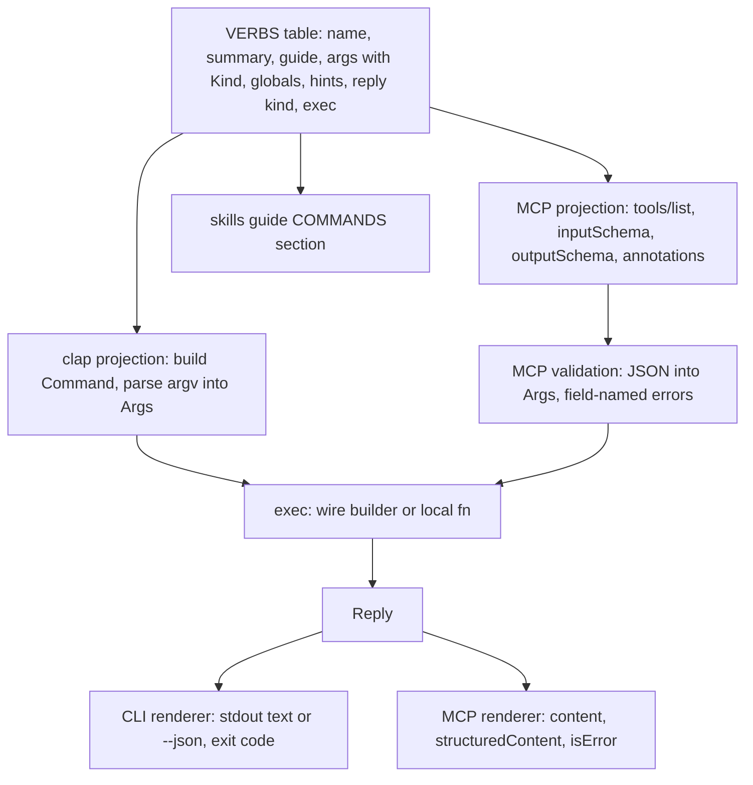

# Unified CLI and MCP Surface - Plan

## Goal Capsule

- **Objective:** an agent or a person who uses agent-mobile gets the same verbs, arguments, filters, help, and validation from the CLI and the MCP server, and a new verb or argument reaches both surfaces the moment it is defined.
- **Means:** one verb registry is the only definition; clap parsing, MCP `tools/list`, MCP validation, the skills guide's command list, and dispatch are projections of it (KTD1).
- **Authority:** the Product Contract R-IDs win on behavior; KTDs win on mechanism; units carry only local deltas.
- **Stop conditions:** stop and report if the registry cannot express a current CLI shape without a surface-specific branch outside `src/surface/` (KTD3), or if a live dogfood shows a client that rejects the generated schemas.
- **Execution profile:** U1-U4 are one atomic migration built by one implementer, with the full gates at its end; U5, U6, and U7 follow in order on the same table file, with U7's README and PRD edits free to run alongside; U8 and U9 close.
- **Finish and ship:** the branch lands as one PR on `main` after CI is green and review findings are resolved.

---

## Product Contract

### Summary

Replace the parallel CLI enum and MCP tool catalog with one verb registry. Both surfaces read it, so they cannot drift. In the same change, `devices` gains filters and structured rows, an MCP agent can pick and release a device, argument faults come back as correctable tool errors, every tool that returns data declares an output schema, and `launch` takes a platform-neutral `app_id`.

### Problem Frame

`src/cli.rs` defines the CLI with a clap derive enum, and `src/mcp/tools.rs` re-declares the same verbs by hand (`NAMES`, `schema()`, `description()`, `prepare()`). Nothing ties them. A rename, a new flag, or new help text on one surface does not reach the other, and no test notices. The MCP side also gives agents a weak contract: `devices` cannot filter and returns `key=value` text with a duplicated `udid`/`id`; the server is fixed to one device at start, so the device list is a dead end; a bad argument returns the JSON-RPC error `Unknown tool or invalid arguments`, which names neither the field nor the fix; no tool has structured output; and `launch` calls an Android package a `bundle_id`.

### Requirements

**Single source of truth**

- R1. Every verb's name, summary, guide text, arguments, global options, annotations, reply kind, and execution are defined once, in one registry.
- R2. The clap CLI, MCP `tools/list` (name, description, `inputSchema`, `outputSchema`, annotations), MCP argument validation, the skills guide's COMMANDS section, and dispatch are all derived from that registry, with no second per-verb list anywhere.
- R3. Adding a verb, an argument, a filter, or a global option in the registry changes both surfaces with no other edit, and a parity test fails when a both-surface verb lacks a CLI-to-MCP equivalence case.

**Devices**

- R4. `devices` takes optional `platform`, `kind`, and `state` filters on both surfaces; filters combine with AND.
- R5. A device row has one identity field, `key`, plus `name`, `platform`, `kind`, `os`, `state`, and `serving`; `id` and `udid` are gone from rows.
- R6. Device `state` is lowercase on both platforms (`booted`, `shutdown`, `device`, `offline`, ...).

**Device selection**

- R7. Every MCP tool that talks to a device accepts an optional `device` argument; it overrides the server's start-up device for that call only and never changes the CLI's remembered default.
- R8. A `release` verb on both surfaces stops the running driver session and its owned resources, and leaves the device itself running; with no session running it reports that and succeeds.
- R9. When a call targets a device while a different device holds the single serve, the error names the serving device and tells the caller to run `release`.

**MCP contract**

- R10. An argument fault in `tools/call` returns a tool result with `isError: true` whose text names the argument, the problem, and the fix; an unknown tool name and a malformed request stay JSON-RPC `-32602`.
- R11. Every tool whose reply carries data declares an `outputSchema` and returns `structuredContent` that conforms to it; the text content keeps the framed compact listing.
- R12. The ref-or-point target of `tap`, `doubletap`, and `hold` is expressed in the input schema itself, with no root `anyOf`/`oneOf`/`allOf`.
- R13. MCP `structuredContent` strings get the same untrusted-text cleaning and size bound as text content.

**Naming and docs**

- R14. `launch` takes `app_id` (an iOS bundle id or an Android package) on both surfaces.
- R15. README, the skills guide, and PRD §5.4 describe the new surface, and the PRD names the registry as the owner of the tool table instead of repeating it.

### Key Decisions

- **One registry drives both surfaces.** (session-settled: user-directed — chosen over keeping the hand-written MCP catalog plus a parity test: the user requires that new vocabulary reaches MCP automatically.) Governs R1, R2, R3.
- **Everything ships in this PR.** (session-settled: user-directed — chosen over a follow-up list: the user asked for no gaps or deferrals.) Governs R1-R15.
- **Filters and structured rows on both surfaces.** (session-settled: user-directed — chosen over MCP-only filters or text rows: user requirement.) Governs R4, R5, R6.
- **Per-call device selection.** (session-settled: user-approved — chosen over a server pinned to one device: the device list was a dead end.) Governs R7, R8, R9.
- **Argument faults are tool errors.** (session-settled: user-approved — chosen over JSON-RPC errors: the model must be able to correct itself, per the MCP spec.) Governs R10.
- **`app_id` replaces `bundle_id`.** (session-settled: user-approved — chosen over the iOS-only name: Android takes a package.) Governs R14.

### Acceptance Examples

- AE1. **Covers R3.** Given a new both-surface verb added to the registry with no equivalence case, when `cargo test` runs, then the parity test fails and names the verb.
- AE2. **Covers R7, R9.** Given the server started with `--device ios:A` and a live serve for `ios:A`, when an agent calls `snapshot` with `device: "android:avd:x"`, then the result is `isError: true`, names `ios:A` as serving, and says to call `release`; the remembered CLI default is still `ios:A`.
- AE3. **Covers R10.** When an agent calls `tap` with `{"target": {"x": 5}}`, then the result is `isError: true` and its text names `target.y` as missing and shows the two valid target shapes.
- AE4. **Covers R4, R5.** When a user runs `agent-mobile devices --platform android --json`, then every row has `platform: "android"`, a `key`, and no `id` or `udid`.

### Scope Boundaries

- The wire protocol between the host and the drivers does not change: `launch` still sends `bundle_id`, and the protocol version stays `1` (KTD7).
- `serve` and `mcp` stay CLI-only; they block for a lifetime and are not tools.
- Considered and not built: a `use_device` tool that changes the server's default. The per-call `device` argument plus `release` covers selection without hidden server state; add it only if agents are seen re-passing `device` on every call as a burden.
- Considered and not built: a cross-platform `ready` state filter. R6 lowercases states but keeps their platform meaning; add a normalized readiness field if agents filter on both platforms' ready states often.
- Considered and not built: a per-client rate limiter. Calls stay serialized through one worker, which bounds concurrency to one; a token bucket is only worth it for a network transport, which this server does not have.

---

## Planning Contract

### Key Technical Decisions

- KTD1. **A const verb table plus a clap builder.** `src/surface/` holds a `const VERBS: &[Verb]` table; the clap `Command` is built from it with the builder API, and MCP schemas and validation read the same table. Rejected: clap derive with runtime introspection, because `tap`/`doubletap`/`hold`/`type` are multi-value positionals whose typed MCP fields (`target`, `ref`, `text`) cannot be recovered from clap metadata; rejected: turning MCP arguments into argv for clap, because MCP `type {"text": "@snap1:e2"}` must stay literal text while the CLI reads a leading ref-shaped word as a ref (pinned today by `named_arguments_preserve_cli_payloads_and_literal_ref_shaped_text` in `src/mcp/tools.rs`, which U4 moves into `src/surface/mcp.rs`). Instantiates the user-directed registry decision; governs R1, R2.
- KTD2. **Typed argument kinds own validation once.** Each argument has a `Kind` (text with a length bound, ref, finite number with bounds, integer, enum, app id, path, and the two compounds in KTD3). One validator per kind serves both surfaces and produces a field-named error with a fix line. Finite checks, ref parsing, app-id character rules, and range rules move out of `cmd/hold.rs`, `cmd/pinch.rs`, and `mcp/tools.rs` into these kinds. CLI `hold --duration` now rejects values outside `0 < d <= 10` locally instead of passing them to the driver; MCP already did.
- KTD3. **Two compound kinds, isolated in `src/surface/`.** `Point` is CLI `<REF> | <X> <Y>` and MCP property `target` with `oneOf` of two closed objects `{ref}` and `{x, y}`, which keeps the root free of combinators (R12). `RefThenText` is CLI `[REF] TEXT...` and MCP properties `ref` (optional) and `text`. No other surface-specific parse exists.
- KTD4. **Execution is declarative where it can be.** A verb's execution is either a wire builder (from parsed arguments to the existing `Request`: route, body, timeout) or a local function (from context and arguments to a `Reply`). `status`, `snapshot`, `tap`, `type`, `swipe`, `home`, `doubletap`, `pinch`, `hold`, `back`, `twofinger`, `center`, `launch`, `stop` become wire builders in the table and their `src/cmd/*.rs` files are deleted; `devices`, `skills`, `scroll_until_visible`, `screenshot`, `release`, `serve`, and `mcp` stay local functions.
- KTD5. **One `Reply` value, two renderers.** Every execution returns a `Reply` (driver envelope, device rows, text, image, written file). The CLI renderer keeps today's stdout bytes and exit codes; the MCP renderer builds `content`, `structuredContent`, and `isError`. This removes the CLI `run()` wrappers and the per-verb special cases in `src/mcp/call.rs`.
- KTD6. **Output schemas per reply kind, metadata only for snapshots.** Four schemas cover every data reply: snapshot (`app`, `snapshot_id`, `ref_count`, `complete`, `settled`, `reads`, `settle_ms`), status (`app`, `snapshot_id`, `device`, `os`), terminate (`terminated`), and devices (`devices` array of R5 rows). The snapshot `structuredContent` omits `tree` and `text`: the framed compact listing in `content` already carries every ref, and repeating the tree as JSON would roughly double the tokens of every action. This departs from the spec's SHOULD that text repeat the JSON; PRD §5.4 records the reason. `skills`, `screenshot`, and `release` have no output schema. Error results carry no `structuredContent`.
- KTD7. **`app_id` is a surface name only.** The registry argument is `app_id`; the wire builder still sends `bundle_id`, so neither driver changes and protocol version `1` holds. Governs R14.
- KTD8. **Device resolution for MCP does not remember.** `Ctx` gains a flag so the MCP path resolves a device key without `remember_device_selection`; the CLI path keeps remembering. The flag also reaches the three other writers: the lazy-boot picks in `src/cmd/lazy.rs` and the registration in `src/cmd/serve.rs`, which a lazy boot reaches through a spawned `serve`; the boot passes a hidden `serve` flag so that process skips the write. Per-call `device`, then the server's `--device`, then the remembered default, in that order. The bench harness's `--device <key> mcp` launch keeps working unchanged.
- KTD9. **`release` stops by recorded identity.** `release` reads the live state row (for the given device, or the single live row), checks the recorded process identity with `process_matches`, sends TERM, and waits for the serve to clear its row for at most 30 s, below the 45 s MCP call budget; a row still present after that returns success with `release in progress; the driver is still shutting down`. It never kills by port or name. The serve lock conflict message (`src/cmd/serve.rs` `acquire_lock`) changes its next step to `release`.
- KTD10. **The parity test checks behavior, not self-agreement.** Two projections of one table trivially agree, so the test asserts: for every both-surface verb, a fixture pair of argv and MCP arguments produces the same execution input, which is the same `Request` (route, body, timeout) for a wire verb and the same parsed `Args` plus context options (device, app, max depth) for a local verb (`devices`, `screenshot`, `scroll_until_visible`, `release`, `skills`); every both-surface verb has such a pair; the generated clap command passes `debug_assert`; and `tools/list` matches a checked-in fixture so any surface change is visible in review.

### High-Level Technical Design

The registry is the only per-verb definition; everything else is a projection.



Directional sketch of one table entry, for shape only:

```text
Verb {
  name: "hold", surface: Both,
  summary: "Press a ref or point for a duration; surfaces context menus.",
  guide: "...native context menus surface in the snapshot...",
  args: [ Arg { name: "target", kind: Point, required },
          Arg { name: "duration", kind: Number { gt: 0, max: 10 }, default: 1.0, flag } ],
  globals: [Device, MaxDepth],
  hints: Action,            // readOnly=false destructive=true idempotent=false openWorld=true
  reply: Snapshot,
  exec: Wire(hold_request),
}
```

### Assumptions

- The CLI is unpublished (no registry release yet), so text-row and JSON-row changes to `devices` and the CLI `hold --duration` range check need no deprecation path; `scripts/benchkit/` and its tests move with them.
- Claude Code and the MCP Inspector accept a nested `oneOf` inside a property; U9's live dogfood confirms it.
- The MCP client in the bench harness tolerates `structuredContent` on results; it ignores fields it does not use.

### System-Wide Impact

- **Bench harness:** `scripts/benchkit/agent.py` reads `--json devices` rows and launches `--device <key> mcp`; U5 moves its row reads to `key`, and KTD8 keeps the launch shape. Agent task prompts name tools, not argument names, so they need no change.
- **CLI consumers:** text and JSON `devices` rows change shape (R5, R6); every other verb keeps its stdout bytes and exit codes (U3).
- **MCP clients:** argument faults move from JSON-RPC errors to `isError` results (R10), results gain `structuredContent` (R11), and `tap`/`doubletap`/`hold` take `target` instead of top-level `ref`/`x`/`y` (R12). Clients that cached `tools/list` refetch on restart; the server has no `listChanged`.
- **Approval boundary:** `release` stops a session a person may have started in a terminal; its `destructiveHint` lets a client ask first, and it acts only on a process whose recorded identity matches (KTD9).

### Risks

- **CLI output regression in the dispatch rewrite.** The rewrite touches every verb's output path; U3 keeps the recorded-fixture byte test and the `tests/cli_*.rs` stub-driver suites as the guard, and no test expectation changes outside the cases U8 names.
- **Client schema support.** A client that rejects a nested `oneOf` would fail to list tools; U9 checks the Inspector, and the PRD's existing rule against root combinators stays.
- **Disk.** One debug build of the workspace fits; all units share one worktree and one target directory, so no second build cache is made.

### Sequencing

U1-U4 are one atomic migration: U2 deletes command modules that the old dispatch still calls until U3 replaces it, and U4 removes the old MCP catalog, so the build is only green again at the end of U4. One implementer builds them in order and runs the full gates once, at the end of U4. U5 (devices), U6 (release and selection), and U7 (guide and docs) each edit their entry in `src/surface/verbs.rs`, so they run in that order; U7's `README.md` and `docs/PRD.md` edits touch no Rust and may run alongside U5 and U6. Each unit updates the existing tests whose expectations its own behavior change breaks. U8 adds the new cross-surface tests once all behavior exists. U9 is the live check.

---

## Implementation Units

### U1. Registry types and clap projection

- **Goal:** the registry types exist and the CLI parses from them.
- **Requirements:** R1, R2, R12 (via KTD1, KTD2, KTD3)
- **Dependencies:** none
- **Files:**
  - create `src/surface/mod.rs` (types: `Verb`, `Arg`, `Kind`, `Global`, `Hints`, `ReplyKind`, `Surface`, parsed `Args`)
  - create `src/surface/kind.rs` (one validator per `Kind`, shared by both surfaces, with field-named errors)
  - create `src/surface/cli.rs` (build the clap `Command` from the table; parse `ArgMatches` into verb plus `Args` plus globals)
  - create `src/surface/kind_tests.rs`
- **Approach:**
  1. `Args` is a small map from argument name to `serde_json::Value`, so both surfaces produce the same shape for the exec layer.
  2. The clap builder maps `Kind` to positional or flag, `num_args`, possible values, and defaults; globals stay `global(true)`.
  3. A global given to a verb that does not list it prints the existing `note: --x is ignored by <verb>` line, now derived from the table.
- **Patterns to follow:** `ref_or_point_body` and `type::split` in `src/cmd/` for the CLI compound parses; error text style of `Failure::usage`.
- **Test scenarios:**
  - `Point` from CLI `["@s:e1"]` gives `{target: {ref}}`; from `["10", "20.5"]` gives `{target: {x: 10.0, y: 20.5}}`; from `["nan", "1"]` fails naming `target`.
  - `RefThenText` from CLI `["@s:e1", "hi", "there"]` gives `ref` plus `text: "hi there"`; from `["@s:e1"]` fails with the existing "needs text after the ref" fix.
  - `Number { gt: 0, max: 10 }` rejects `0`, `-1`, `11`, `NaN`, and accepts `10`.
  - `AppId` rejects `a;b` and an empty string with an error that names the argument.
  - `Enum` rejects a value outside its set and lists the allowed values in the fix line.
- **Verification:** the unit tests pass, and the generated clap command passes `debug_assert`.

### U2. Verb table and execution builders

- **Goal:** every verb is one table entry, and the per-verb wrapper files are gone.
- **Requirements:** R1, R14 (via KTD4, KTD7)
- **Dependencies:** U1
- **Files:**
  - create `src/surface/verbs.rs` (the `VERBS` table and the wire builders)
  - modify `src/cmd/scroll.rs`, `src/cmd/screenshot.rs`, `src/cmd/devices.rs`, `src/cmd/skills.rs`, `src/cmd/serve.rs` (local functions take context plus `Args` and return `Reply`)
  - delete `src/cmd/back.rs`, `src/cmd/center.rs`, `src/cmd/doubletap.rs`, `src/cmd/hold.rs`, `src/cmd/home.rs`, `src/cmd/launch.rs`, `src/cmd/pinch.rs`, `src/cmd/snapshot.rs`, `src/cmd/status.rs`, `src/cmd/stop.rs`, `src/cmd/swipe.rs`, `src/cmd/tap.rs`, `src/cmd/twofinger.rs`, `src/cmd/type.rs`
- **Approach:**
  1. Move each wire builder's body and timeout rule into the table file; keep the hold budget formula and `LONG_TIMEOUT` for `type` and `launch`.
  2. `launch` reads `app_id` and sends `bundle_id` on the wire (KTD7).
  3. If `verbs.rs` passes 400 lines, split the wire builders into `src/surface/wire.rs`.
- **Patterns to follow:** the existing `Request` struct in `src/cmd/reply.rs`.
- **Test scenarios:**
  - `hold` with a 3 s duration keeps a 33 s wire budget; with no duration it sends `duration: 1.0`.
  - `launch` with `app_id: "com.pkg"` sends wire body `{"bundle_id": "com.pkg"}`.
  - `stop` maps to the `terminate` route.
- **Verification:** none on its own; the build is green again only at the end of U4 (see Sequencing).

### U3. CLI dispatch and rendering through `Reply`

- **Goal:** the binary parses, executes, and prints only through the registry.
- **Requirements:** R2 (via KTD5, KTD8)
- **Dependencies:** U2
- **Files:**
  - modify `src/main.rs`, `src/cmd/mod.rs`, `src/cmd/reply.rs`
  - delete `src/cli.rs`
  - modify `src/cmd/tests.rs`
  - modify `tests/cli_gestures.rs` (`hold_zero_duration_passes_through` and `hold_negative_duration_passes_through` become local usage-error cases per KTD2)
- **Approach:**
  1. `main` builds the command from the table, parses, and calls one dispatch that runs the verb's exec and renders the `Reply`.
  2. Both `match` blocks in `src/cmd/mod.rs` and `Command::name()` go away.
  3. `Ctx` gains the remember flag from KTD8; the CLI sets it.
  4. The `--json` failure envelope still names the verb.
- **Patterns to follow:** `Ctx::finish` for the CLI text and JSON output contract.
- **Test scenarios:**
  - `snapshot --json` output bytes match the current recorded fixture test in `src/cmd/reply.rs`.
  - A usage error exits `2`; a driver error exits `1`; a closed stdout pipe exits `0`.
  - `--app` on `tap` prints the ignored-flag note on stderr.
- **Verification:** at the end of U4, the `tests/cli_*.rs` suites pass against the stub driver with no test edits other than the `hold` range cases above.

### U4. MCP projection, validation errors, and structured output

- **Goal:** `tools/list` and `tools/call` come from the registry, with field-named tool errors and structured results.
- **Requirements:** R2, R10, R11, R12, R13 (via KTD3, KTD5, KTD6)
- **Dependencies:** U3
- **Files:**
  - create `src/surface/mcp.rs` (input schema per `Kind`, output schema per `ReplyKind`, annotations from `Hints`, descriptions from summary plus guide)
  - modify `src/mcp/mod.rs`, `src/mcp/call.rs`, `src/mcp/frame.rs`
  - delete `src/mcp/tools.rs` (move its two tests into `src/surface/mcp.rs` first)
  - modify `tests/mcp_stdio.rs` (argument-fault cases expect `isError` instead of `-32602`)
- **Approach:**
  1. `tools/call`: unknown tool name, non-object params, or an unknown top-level params key stay `-32602`; anything wrong inside `arguments` becomes an `isError` result with text `BAD_REQUEST: <field>: <problem>` and a `next:` fix line (R10).
  2. Every device-bound tool lists `device`; snapshot-returning tools list `max_depth`; `snapshot` and `scroll_until_visible` list `app`; all from the table's globals.
  3. `frame` gains a cleaner for JSON string leaves (control-character strip, bidi strip, per-string cap) used on `structuredContent` (R13).
  4. Tool descriptions append the ref-freshness sentence to any verb with a ref argument, derived from the args.
- **Patterns to follow:** `src/mcp/frame.rs` text framing; `protocol::complete` for modern result metadata.
- **Test scenarios:**
  - Covers AE3. `tap` with `{"target": {"x": 5}}` returns `isError: true` naming `target.y`.
  - `tap` with an unknown argument `foo` returns `isError: true` naming `foo` and listing the allowed arguments.
  - A call to tool `nope` returns JSON-RPC `-32602`.
  - `snapshot` returns `structuredContent` with `snapshot_id` and `settled`, no `tree`, and the framed listing as text.
  - A device name with a control character and a 5000-character app id are cleaned and bounded in `structuredContent`.
  - Every tool with an `outputSchema` returns `structuredContent` on success; `screenshot` returns image content and no `outputSchema`.
- **Verification:** every gate in the Verification Contract passes, including `tests/mcp_stdio.rs` with its updated argument-fault cases.

### U5. Devices filters and rows

- **Goal:** `devices` filters by platform, kind, and state, and returns key-based rows with lowercase state.
- **Requirements:** R4, R5, R6
- **Dependencies:** U4
- **Files:**
  - modify `src/cmd/devices.rs`, `src/platform.rs` (lowercase state at the `state()` accessor)
  - modify the `devices` entry in `src/surface/verbs.rs` (three optional enum or text filters)
  - modify `scripts/benchkit/select.py`, `scripts/benchkit/agent.py` (`pick_device` matches on `key` and sorts by lowercase `booted`/`device`), `scripts/bench_test.py`, `scripts/agent_test.py`
  - modify the `devices` row cases in `tests/cli_*.rs` and the `row_tests` module in `src/cmd/devices.rs`
- **Approach:**
  1. `platform` is enum `ios|android`; `kind` is enum `simulator|device|emulator|usb|wireless`; `state` is text matched after lowercasing.
  2. Text rows start with `key=` and drop `udid=` and `id=`.
  3. `select.py` matches on `key` (split for the id) and keeps its legacy branch for old binaries.
- **Patterns to follow:** `row_json` and `row_text` in `src/cmd/devices.rs`.
- **Test scenarios:**
  - Covers AE4. `--platform android` keeps only Android rows; rows have `key` and no `id`/`udid`.
  - `--kind simulator --state booted` keeps only booted iOS simulators; an iOS state `Booted` reports `booted`.
  - No filter returns every row in discovery order.
  - `select.py` picks the right device from new rows and still reads a legacy `udid`-only row.
  - `agent.py` `pick_device` prefers a `booted` simulator over a `shutdown` one with lowercase states.
- **Verification:** the Rust row tests and `python3 -m unittest discover -s scripts -p '*_test.py'` pass.

### U6. Per-call device and `release`

- **Goal:** an MCP agent picks a device per call and can release the running session.
- **Requirements:** R7, R8, R9 (via KTD8, KTD9)
- **Dependencies:** U4
- **Files:**
  - create `src/cmd/release.rs`
  - modify `src/cmd/serve.rs` (`acquire_lock` next step), `src/cmd/lazy.rs` (surface the serving device when the lock blocks a boot)
  - modify the `release` entry in `src/surface/verbs.rs`
  - create `tests/cli_release.rs`
- **Approach:**
  1. `release` with `device` stops that device's live session; without it, the single live session; with none, it returns `no driver running` and exits `0`.
  2. Hints for `release`: not read-only, destructive, idempotent, not open-world.
  3. A lazy boot that loses to a live serve for another device fails fast with R9's message instead of waiting out the boot budget.
- **Patterns to follow:** `process_matches` and `terminate` in `crates/core/src/process.rs`; `SERVE_CLEANUP_BUDGET` in `src/cmd/lazy.rs`.
- **Test scenarios:**
  - Covers AE2. With a live serve row for `ios:A`, an MCP `snapshot` with `device: "android:avd:x"` returns `isError` naming `ios:A` and `release`, and `state.json` still remembers `ios:A`.
  - `release` with a live stub serve sends TERM, waits, and the state row is gone.
  - `release` with no live row prints `no driver running` and exits `0`.
  - An MCP `snapshot` with `device` set to a device that is not live lazy-boots it, and `state.json` still remembers the previous default afterwards (KTD8).
  - `release` on a serve that does not clear its row within 30 s returns success with `release in progress`.
  - `release` with a row whose recorded process identity does not match the live pid does not signal it and reports a stale row.
- **Verification:** `tests/cli_release.rs` and the MCP stdio selection case pass.

### U7. Skills guide and docs from the registry

- **Goal:** the guide's command list is generated, and the docs match the new surface.
- **Requirements:** R2, R15
- **Dependencies:** U4
- **Files:**
  - modify `src/cmd/skills.rs` (COMMANDS section rendered from the table; other sections stay static)
  - modify `tests/cli_guide.rs` (drop the two-way command-name check the generator makes true; keep the checks on static sections)
  - modify `README.md`, `docs/PRD.md` (§5.2 command list and §5.4 MCP server)
- **Approach:**
  1. The per-verb guide text in the table replaces the hand-written COMMANDS block, so the guide, `--help`, and MCP descriptions share one text.
  2. PRD §5.4: replace the annotation table with a pointer to the registry; record KTD6's text-not-JSON reason; record R10's split of protocol and tool errors; name `release` and per-call `device`.
  3. README: the commands table gains `release`; MCP section documents `device`, `target`, `app_id`, `structuredContent`, and `isError` argument faults; `devices` shows its filters.
- **Test scenarios:**
  - `agent-mobile skills` lists every both-surface and CLI verb exactly once, in table order.
  - The static ENV and SESSIONS sections still match the env vars the code reads.
- **Verification:** `tests/cli_guide.rs` passes and the README commands table matches `agent-mobile --help`.

### U8. Cross-surface parity and contract tests

- **Goal:** tests that fail when the surfaces stop matching or the MCP contract changes unseen.
- **Requirements:** R3 (via KTD10)
- **Dependencies:** U5, U6, U7
- **Files:**
  - create `src/surface/parity_tests.rs`
  - create `tests/fixtures/tools-list.json`
- **Approach:**
  1. One table of `(verb, argv, mcp_arguments)` cases; each produces the same execution input from both surfaces, per KTD10.
  2. A check that every both-surface verb in `VERBS` appears in that case table.
  3. `tools/list` compared with the fixture; on mismatch the message tells the author to review and update the fixture.
- **Test scenarios:**
  - Covers AE1. Removing one case from the case table fails the coverage check, and the failure names the verb.
  - `type` CLI `["@s:e1", "hi"]` and MCP `{"ref": "@s:e1", "text": "hi"}` give the same body; MCP `{"text": "@s:e1"}` stays text.
  - `tools/list` lists `release` and does not list `serve` or `mcp`.
  - `devices` CLI `["--platform", "android"]` and MCP `{"platform": "android"}` give the same parsed `Args` and the same local executor.
- **Verification:** `cargo test --workspace` passes.

### U9. Live dogfood on both platforms

- **Goal:** the new surface works through a real client on real targets.
- **Requirements:** R4, R7, R8, R10, R11, R12
- **Dependencies:** U8
- **Files:** none (verification only)
- **Approach:** drive the Android API 37 emulator and the iOS simulator only through `agent-mobile` and the MCP Inspector 2.11.0 CLI.
- **Test scenarios:**
  - `tools/list` returns the fixture's tools, and the Inspector accepts the nested `target` schema.
  - `devices` with `platform: "android"` returns only the emulator row.
  - `snapshot` with `device` set to the emulator key, then `tap` with `target.ref`, then `release`; then `snapshot` with `device` set to the simulator key boots iOS.
  - `tap` with a bad target returns `isError` with the field named.
- **Verification:** every scenario's output is captured in the PR body.

---

## Verification Contract

| Gate | Command | When |
|---|---|---|
| Format | `cargo fmt --all -- --check` | end of U4, then every unit |
| Lint | `cargo clippy --workspace --all-targets --locked -- -D warnings` | end of U4, then every unit |
| Source rules | `scripts/check-rust-source.sh` (400-line files, no inline comments, doc comments at most 15 lines) | end of U4, then every unit |
| Rust tests | `cargo test --workspace --locked` | end of U4, then every unit |
| Script tests | `python3 -m unittest discover -s scripts -p '*_test.py'` | U5, U8 |
| Supply chain | `cargo deny check` | before the PR (no new dependency is planned) |
| MCP smoke | `npx @modelcontextprotocol/inspector@2.11.0 --cli <bin> mcp --method tools/list` | U4, U9 |
| Live dogfood | U9 scenarios on `android:avd:agent-mobile-api37` and the iPhone 17 Pro Max simulator | U9 |

Run one Gradle or Xcode build at a time; the host has 16 GB RAM and about 6 GB free disk. No driver source changes, so no driver rebuild is needed beyond what lazy boot does.

---

## Definition of Done

- `src/cli.rs` and `src/mcp/tools.rs` are deleted, and no per-verb list exists outside `src/surface/verbs.rs`.
- The net line count of `src/` goes down.
- R1-R15 each map to a passing test or a captured U9 scenario.
- Every gate in the Verification Contract passes.
- No file names another mobile-automation tool or product, and no check for such names is added.
- Abandoned-attempt code and scratch files are removed, and the worktree is cleaned after merge.
